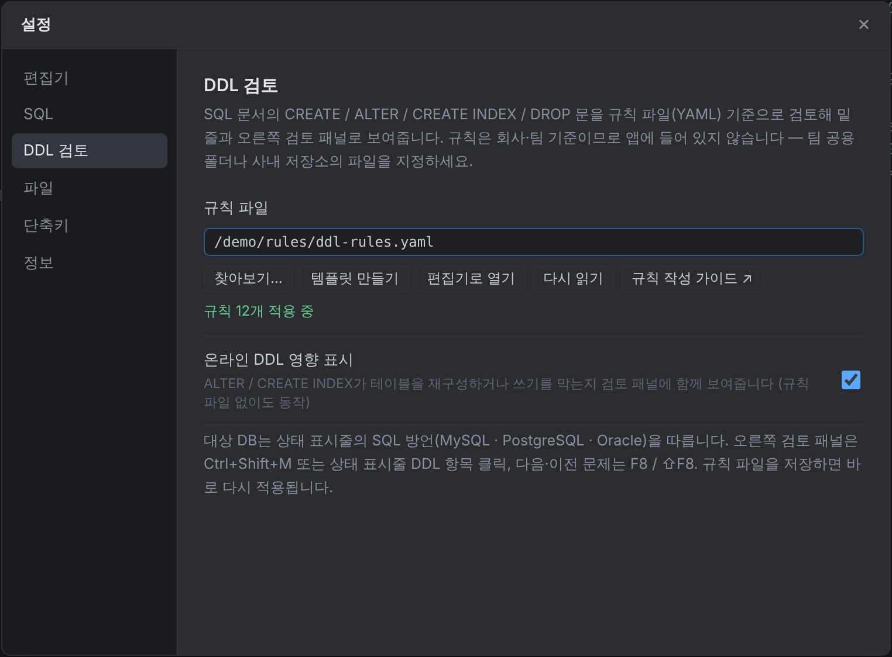
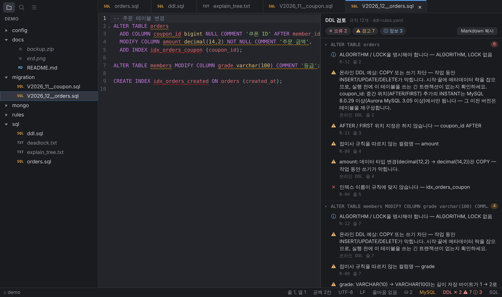

# DDL 검토 사용법
{: .no_toc }

SQL 문서의 DDL을 팀 규칙으로 검토하고, 작업이 테이블을 막는지(온라인 DDL 영향) 함께 보여줍니다. 규칙은 앱에 들어 있지 않고, 팀이 직접 만든 YAML 파일을 불러옵니다. 작업 DDL의 롤백 스크립트도 만들 수 있습니다.
{: .fs-5 .fw-300 }

1. TOC
{:toc}

---

## 1. 규칙 파일 지정

1. 설정(`⌘,` / `Ctrl+,`) → **DDL 검토**를 엽니다.
2. 처음이라면 **템플릿 만들기**를 누릅니다. 모든 검사가 설명과 예시 값까지 주석으로 들어 있는 `ddl-rules.yaml`이 설정 폴더에 생기고 편집기로 열립니다.
3. 쓰려는 규칙의 `#`을 지우고 값을 팀 기준으로 바꿔 저장합니다. 저장하는 즉시 적용됩니다.
4. 팀이 같이 쓰려면 파일을 팀 공용 폴더나 사내 저장소에 두고 **찾아보기…**로 그 경로를 지정합니다.

{: .warning }
회사·팀 규칙에는 내부 명명 규칙이 들어 있으므로 공개 저장소에 올리지 마세요.

{: width="560" }

규칙 파일에 오류(없는 검사 이름, 잘못된 정규식 등)가 있으면 그 규칙만 건너뛰고, 설정 화면에 어느 규칙이 왜 잘못됐는지 표시합니다. 규칙을 쓰는 방법은 [규칙 작성 가이드](ddl-rules.html)를 보세요.

## 2. 검토 결과 보기

규칙이 적용되면 SQL 문서를 쓰는 동안 자동으로 검토합니다.


- **밑줄** — 위반 위치에 표시되고, 마우스를 올리면 메시지가 나옵니다.
- **상태 표시줄** — `DDL ✕2 ⚠5 ⓘ1`처럼 오류·경고·정보 개수가 나옵니다. 위반이 없으면 `DDL ✓`.
- **오른쪽 검토 패널** — `⇧⌘M`(Windows `Ctrl+Shift+M`), 상태 표시줄 클릭, 또는 보기 메뉴 → **DDL 검토 패널**.
  - 결과를 `CREATE TABLE …` 같은 문장 단위로 묶어 보여줍니다. 문장 머리를 누르면 접힙니다.
  - 상단의 오류·경고·정보 칩을 누르면 그 종류를 숨기거나 다시 보입니다.
  - 항목을 누르면 편집기에서 해당 위치로 이동합니다.
  - **Markdown 복사**로 결과를 표로 복사해 티켓·리뷰 코멘트에 붙일 수 있습니다.
- **다음 / 이전 문제** — `F8` / `⇧F8`.

## 3. 대상 DB

상태 표시줄의 SQL 방언을 따릅니다.

| 방언 | DDL 해석 |
| --- | --- |
| MySQL | MySQL / Aurora / MariaDB 문법. `DELIMITER` 스크립트 지원 |
| PostgreSQL | `COMMENT ON`, `GENERATED … AS IDENTITY`, `CREATE INDEX CONCURRENTLY` 등 |
| Oracle | `COMMENT ON`, `TABLESPACE`, `ONLINE`, PL/SQL 블록(`/`로 끝나는 단위) |

방언을 바꾸면 즉시 다시 검토합니다. 규칙마다 `db:`로 적용할 DB를 정할 수 있습니다.

## 4. 검토하는 문장

| 문장 | 내용 |
| --- | --- |
| `CREATE TABLE` | 테이블·컬럼·인덱스·제약·테이블 옵션 |
| `ALTER TABLE` | ADD / MODIFY / CHANGE / ALTER COLUMN, ADD / DROP INDEX, DROP / RENAME COLUMN, ALGORITHM / LOCK |
| `CREATE INDEX` | 인덱스 이름, CONCURRENTLY / ONLINE |
| `COMMENT ON` | PostgreSQL / Oracle의 테이블·컬럼 코멘트를 같은 문서 안에서 인정 |
| `CREATE VIEW` 등 | VIEW, MATERIALIZED VIEW, SEQUENCE, TRIGGER, PROCEDURE, FUNCTION, PACKAGE, EVENT, SYNONYM의 이름 |
| `DROP` / `TRUNCATE` / `RENAME` | 금지 구문 검사 |

SELECT·INSERT 같은 DML은 검토하지 않습니다.

## 5. 온라인 DDL 영향

규칙 파일이 없어도 ALTER TABLE / CREATE INDEX마다 데이터베이스가 작업을 어떻게 실행할지 예상해 검토 패널에 `온라인 DDL`로 보여줍니다. 쓰기를 막는 작업은 경고(⚠), 나머지는 정보(ⓘ)입니다. 설정 > DDL 검토 > **온라인 DDL 영향 표시**로 끌 수 있습니다.



| DB | 표시 |
| --- | --- |
| MySQL 8.0 / Aurora MySQL 3 | **INSTANT**(메타데이터만), **INPLACE**(DML 허용), **INPLACE + 테이블 재구성**(DML 허용, 시간·디스크 필요), **COPY / 쓰기 차단** |
| PostgreSQL | 메타데이터만 변경 / 테이블 재작성 / 쓰기 차단(ACCESS EXCLUSIVE 등) |
| Oracle | 온라인 진행 / 쓰기 차단 |

판단에 쓰는 것:

- **변경 전 컬럼 정의** — 폴더 안 DDL 파일의 CREATE TABLE에서 찾습니다. 그래서 `VARCHAR(50) → VARCHAR(100)`처럼 길이 저장 바이트가 255바이트 경계를 넘는 변경(COPY)과 넘지 않는 변경(INPLACE)을 구분합니다. 찾지 못하면 "확인 필요"로 표시합니다.
- **같은 스크립트에서 만든 테이블**은 비어 있으므로 표시하지 않습니다.
- **ALGORITHM / LOCK 지정** — 지정한 방식으로 실행할 수 없는 변경이 섞여 있으면(예: `ALGORITHM=INSTANT` + 인덱스 추가) 오류가 난다고 알려줍니다.
- 버전에 따라 달라지는 것(중간 위치 컬럼 추가·컬럼 삭제의 INSTANT는 MySQL 8.0.29 / Aurora MySQL 3.05 이상)은 메시지에 함께 적습니다.

{: .note }
예상치입니다. 실제 동작은 버전·테이블 상태(FULLTEXT 인덱스, 행 형식 등)에 따라 달라질 수 있으니, 큰 테이블은 사용량이 적은 시간에 작업하고 실행 전에 해당 테이블을 쓰는 긴 트랜잭션이 없는지 확인하세요.

## 6. 롤백 스크립트

작업 DDL을 연 상태에서 우클릭 → **롤백 스크립트 만들기 (새 탭)** (또는 보기 메뉴). 선택 영역이 있으면 그 부분만 되돌립니다. 작업 문장을 역순으로 되돌리는 SQL이 새 탭에 열립니다.

```sql
-- [1] 2행: ALTER TABLE orders ADD COLUMN coupon_id bigint NULL …
ALTER TABLE orders
    DROP INDEX idx_orders_coupon,
    MODIFY COLUMN amount decimal(12,2), -- 변경 전 정의 sql/ddl.sql:4
    DROP COLUMN coupon_id;
```

| 작업 | 롤백 |
| --- | --- |
| CREATE TABLE / INDEX / VIEW … | DROP |
| ADD COLUMN / INDEX / 제약 | DROP COLUMN / INDEX / CONSTRAINT |
| RENAME (테이블·컬럼) | 반대 방향 RENAME |
| MODIFY / CHANGE / ALTER COLUMN TYPE | 폴더 DDL의 **변경 전 정의**로 되돌림 |
| DROP COLUMN / INDEX / TABLE | 폴더 DDL의 원래 정의로 다시 만듦 — **데이터는 복구되지 않음** |
| COMMENT ON, 테이블 옵션 | 원래 코멘트·값 |
| TRUNCATE, 이전 정의를 모르는 CREATE OR REPLACE | ✕ 자동으로 되돌릴 수 없음 |

변경 전 정의는 폴더 안 DDL 파일(작업 파일 자신은 제외)의 CREATE TABLE에서 가져오고, 어느 파일 몇 번째 줄인지 주석으로 남깁니다. 찾지 못한 부분은 추측하지 않고 `-- ⚠ 확인 필요` 주석과 빈칸(`<원래 정의>`)으로 남깁니다.

{: .warning }
폴더의 DDL이 **변경 전 상태**여야 롤백이 맞습니다. 스키마 파일을 이미 변경 후 상태로 고쳐 두었다면 주석에 적힌 위치를 보고 직접 확인하세요.

