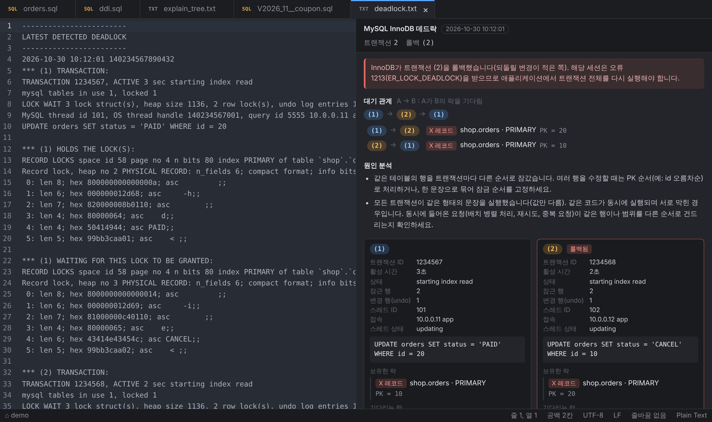

# 데드락 분석
{: .no_toc }

DB가 남긴 데드락 기록을 붙여 넣으면 누가 무엇을 잡고 무엇을 기다렸는지, 어느 쪽이 롤백됐는지, 왜 생겼을 가능성이 큰지 보여줍니다.
{: .fs-5 .fw-300 }

1. TOC
{:toc}

---

## 1. 사용법

1. 새 탭(`⌘N` / `Ctrl+N`)이나 `.txt` / `.log` 파일에 데드락 기록을 붙여 넣습니다. 로그 파일을 그대로 열어도 됩니다.
2. `⌥⌘E`(Windows `Ctrl+Alt+E`) — 실행계획과 같은 단축키입니다. 문서 내용을 보고 데드락인지 자동으로 구분합니다.
3. 오른쪽 패널에서 항목(SQL, 락, 대기 관계)을 누르면 원문의 해당 줄로 이동합니다.

문서에 데드락이 여러 개 있으면(에러 로그) 모두 순서대로 보여줍니다.

## 2. 붙여 넣을 기록

| DB | 가져오는 방법 |
| --- | --- |
| MySQL / Aurora | `SHOW ENGINE INNODB STATUS\G` 결과 전체 또는 `LATEST DETECTED DEADLOCK` 부분. `innodb_print_all_deadlocks = ON`이면 에러 로그에 모든 데드락이 남습니다(Aurora·RDS는 콘솔 로그). mysql 클라이언트 표 출력처럼 줄바꿈이 `\n`으로 보이는 한 줄짜리도 인식합니다. |
| PostgreSQL | 서버 로그의 `ERROR:  deadlock detected` 줄과 이어지는 `DETAIL` / `CONTEXT` / `STATEMENT` 줄. 클라이언트가 받은 오류 메시지만 있으면 쿼리 없이 프로세스·락만 보입니다. |
| Oracle | `ORA-00060`이 남긴 트레이스 파일(alert 로그에 경로가 나옵니다). `Deadlock graph`, `Rows waited on`, 세션 정보 부분을 사용합니다. |

{: .warning }
데드락 기록에는 실제 쿼리와 키 값이 들어 있습니다. 공개 이슈나 외부 채널에 붙이기 전에 값을 가리세요.

## 3. 화면 읽기

- **머리** — DB, 발생 시각, 트랜잭션(세션) 수, 롤백된 쪽.
- **롤백 안내** — DB마다 롤백 범위가 다릅니다.
  - MySQL은 트랜잭션 전체를 롤백합니다(오류 1213).
  - PostgreSQL도 트랜잭션 전체를 중단합니다(오류 40P01).
  - Oracle은 **현재 문장만** 롤백하고 트랜잭션은 열어 둡니다. 애플리케이션이 ROLLBACK하지 않으면 상대 세션은 계속 기다립니다.
- **대기 관계** — `A → B`는 A가 B가 가진 락을 기다린다는 뜻입니다. 순환(`(1) → (2) → (1)`)이 데드락입니다.
- **원인 분석** — 락 종류와 문장 모양으로 추정한 원인과 대응 방법입니다. 확정 진단이 아니라 출발점으로 쓰세요.
- **트랜잭션 카드** — 접속 정보, 실행 중이던 SQL, 보유한 락, 기다리는 락(빨간 줄).
  - 기울어진 흐린 항목은 기록에 없어서 상대 쪽 정보로 **추정**한 락입니다.

## 4. 락 표시

### MySQL InnoDB

| 표시 | 의미 |
| --- | --- |
| `X 레코드` / `S 레코드` | 그 행만 잠금 (`locks rec but not gap`) |
| `X 넥스트키` | 행 + 그 앞의 빈 범위 (REPEATABLE READ의 기본 범위 잠금) |
| `X 갭` | 행 사이의 빈 범위만 잠금 — INSERT를 막음 |
| `X INSERT 의도` | 빈 범위에 INSERT하려고 기다리는 락 — 갭 / 넥스트키 락과 충돌 |
| `IX 테이블` 등 | 테이블 락 |

레코드 값은 인덱스 키를 풀어서 보여줍니다.

- PRIMARY: `PK = 20`
- 보조 인덱스: `키 = (77, 1001)` — 인덱스 컬럼 뒤에 PK가 붙습니다.
- `supremum`은 인덱스의 마지막 값 뒤, 즉 끝 범위입니다.

정수·문자열·DATETIME은 값으로, 나머지는 16진수로 보여줍니다.

### PostgreSQL

| 표시 | 의미 |
| --- | --- |
| `ShareLock` · 트랜잭션 N | 트랜잭션 N이 수정한 행을 기다림 — 사실상 행 락 |
| `ExclusiveLock` · tuple | 같은 행(ctid)에 대한 대기 순서 락 |
| `AccessExclusiveLock` · relation | 테이블 전체 락 (DDL, LOCK TABLE 등) |

relation 번호(OID)는 원인 분석에 나오는 `SELECT 16390::regclass;`로 이름을 확인하세요.

### Oracle

| 리소스 | 의미 |
| --- | --- |
| `TX` | 행 락(트랜잭션). X로 기다리면 일반 행 충돌, S로 기다리면 ITL 부족·유니크 키 동시 INSERT·비트맵 인덱스 |
| `TM` | 테이블 락. 대부분 **인덱스 없는 외래키** — `object_id`로 테이블을 찾아 자식 테이블의 FK 컬럼 인덱스를 확인 |
| `UL` | DBMS_LOCK 사용자 락 |

## 5. 자주 나오는 원인

| 원인 분석 문구 | 흔한 상황 | 대응 |
| --- | --- | --- |
| 다른 순서로 잠갔습니다 | 두 요청이 같은 행들을 반대 순서로 UPDATE | PK 순서로 정렬해 처리, 한 문장으로 묶기 |
| 갭 락과 INSERT 의도 락의 충돌 | "없으면 INSERT"를 동시에 실행 | `INSERT … ON DUPLICATE KEY UPDATE`, READ COMMITTED |
| S → X 업그레이드 | 중복 키 INSERT 후 UPDATE, 공유 락으로 읽은 뒤 수정 | 처음부터 `FOR UPDATE` |
| 외래키 검사 | 부모 수정과 자식 INSERT가 엇갈림 | 부모 → 자식 순서 통일, (Oracle) FK 인덱스 |
| 같은 형태의 문장 | 같은 코드가 병렬로 실행 | 배치 분할 기준·정렬 확인, 재시도 로직 |
