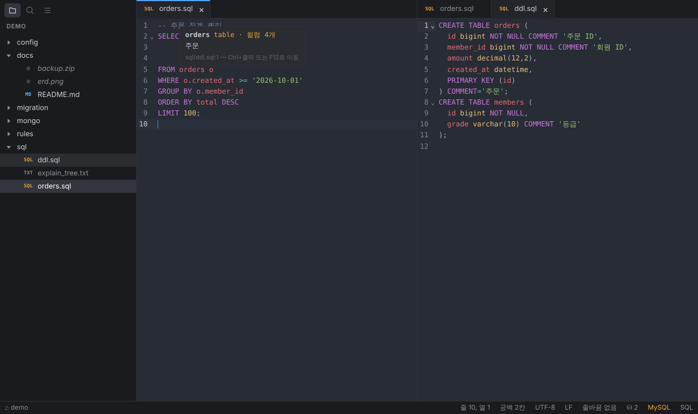
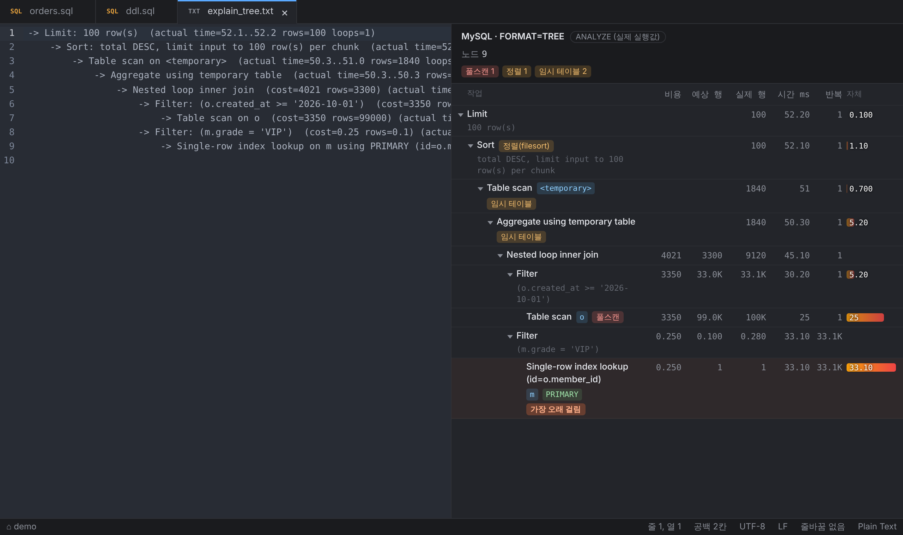
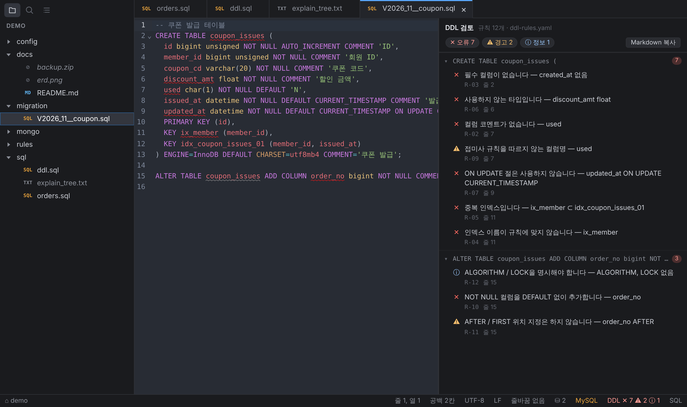

# ArgusCode

DBA를 위한 가벼운 데스크톱 편집기입니다. SQL · Markdown · JSON · YAML · JavaScript(mongosh) · Shell 파일을 빠르게 열고, 실행계획을 읽고, DDL을 회사 규칙으로 검토합니다.
{: .fs-5 .fw-300 }

[최신 버전 내려받기](https://github.com/sizzlei/argusCode/releases/latest){: .btn .btn-primary .mr-2 }
[DDL 규칙 작성 가이드](ddl-rules.html){: .btn }



---

## 주요 기능

| 기능 | 내용 |
| --- | --- |
| SQL | 정렬(대소문자 유지, 왼쪽 정렬 / 리버), 폴더 DDL 기반 테이블·컬럼 자동완성, 호버·정의로 이동, IN 목록 변환 |
| 실행계획 | MySQL(JSON·TREE·ANALYZE), PostgreSQL(JSON·텍스트), Oracle(DBMS_XPLAN·ALLSTATS), MongoDB·DocumentDB(explain) 결과를 트리로 보고 병목·풀스캔·추정 오차를 표시 |
| DDL 검토 | 팀 규칙 파일(YAML)로 CREATE / ALTER / INDEX를 검토해 밑줄과 오른쪽 패널로 표시 — [사용법](ddl-review.html) · [규칙 작성](ddl-rules.html) |
| MongoDB | mongosh 스크립트 자동완성·정렬, 프로파일러·슬로우 로그의 명령을 mongosh 쿼리로 변환 |
| 편집기 | 폴더 트리, 탭·분할, 빠른 열기, 폴더 검색/바꾸기, 개요, 비교, 자동 저장, 외부 변경 감지 |

### 실행계획 보기

MySQL `EXPLAIN ANALYZE` 결과를 붙여 넣고 `⌥⌘E`를 누르면 오른쪽에 트리로 보여줍니다. 풀스캔·정렬·임시 테이블을 표시하고, 가장 오래 걸린 단계를 강조합니다.



### DDL 검토

팀 규칙으로 DDL을 검토해 밑줄과 오른쪽 패널로 보여줍니다. → [사용법](ddl-review.html)



## 설치

[Releases](https://github.com/sizzlei/argusCode/releases/latest)에서 운영체제에 맞는 파일을 받습니다.

| OS | 파일 |
| --- | --- |
| macOS (Apple Silicon / Intel) | `ArgusCode-macos-universal.zip` |
| Windows 10/11 (x64) | `ArgusCode-windows-amd64.zip` |

{: .note }
> **macOS**: 아직 Apple 공증을 받지 않은 앱입니다. 처음 실행할 때 "열지 않음" 경고가 나오면 **완료**를 누른 뒤
> 시스템 설정 → 개인정보 보호 및 보안 → **그래도 열기**를 선택하거나, 터미널에서 실행하세요.
> ```bash
> xattr -dr com.apple.quarantine /Applications/ArgusCode.app
> ```
>
> **Windows**: SmartScreen 경고가 나오면 **추가 정보 → 실행**을 선택하세요.

## 자주 쓰는 단축키

| 기능 | macOS | Windows |
| --- | --- | --- |
| 빠른 열기 | `⌘P` | `Ctrl+P` |
| 문서 정렬 | `⇧⌥F` | `Shift+Alt+F` |
| 실행계획 보기 | `⌥⌘E` | `Ctrl+Alt+E` |
| DDL 검토 패널 / 다음 문제 | `⇧⌘M` / `F8` | `Ctrl+Shift+M` / `F8` |
| 개요 | `⌥⌘O` | `Ctrl+Alt+O` |
| 설정 | `⌘,` | `Ctrl+,` |

전체 기능과 단축키는 [README](https://github.com/sizzlei/argusCode#readme)에 있습니다.
